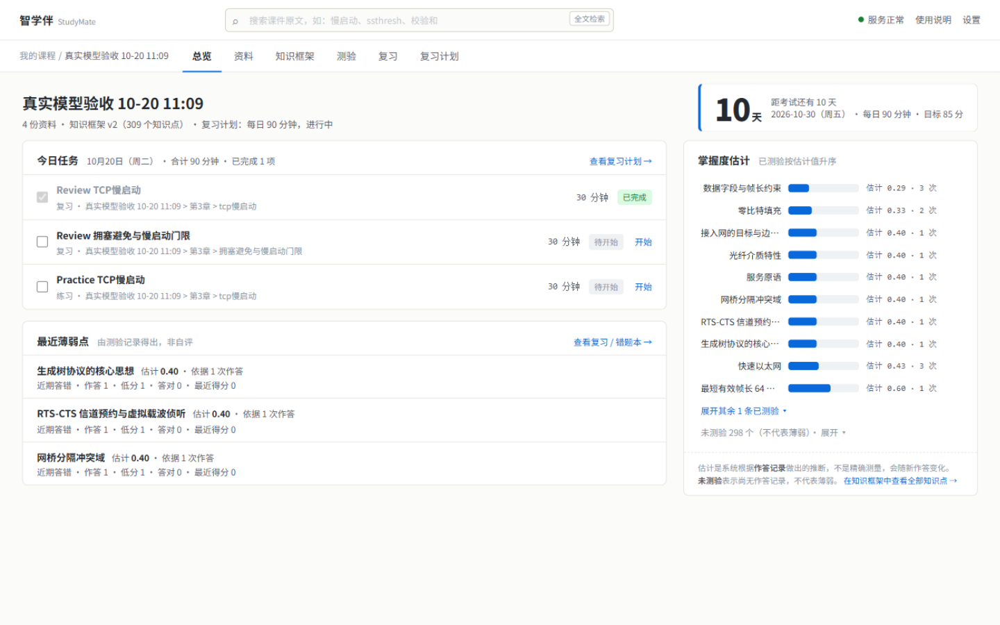
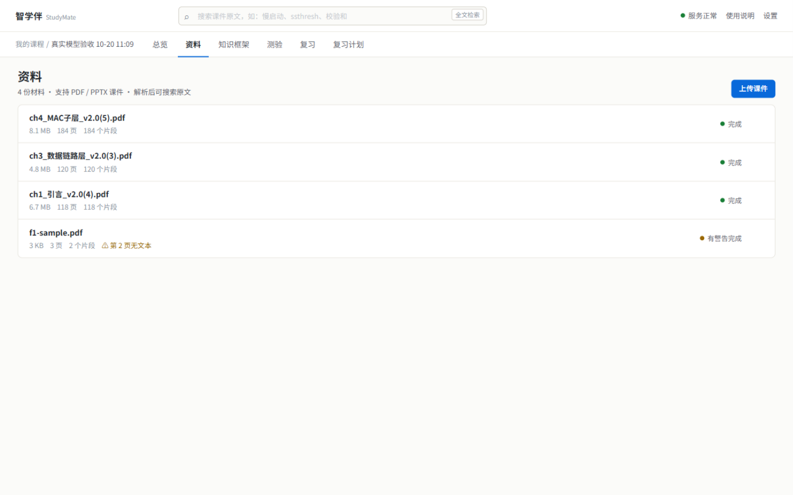
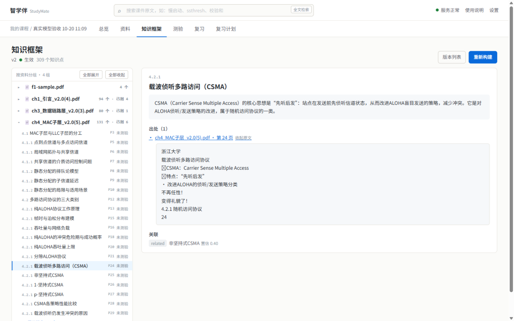
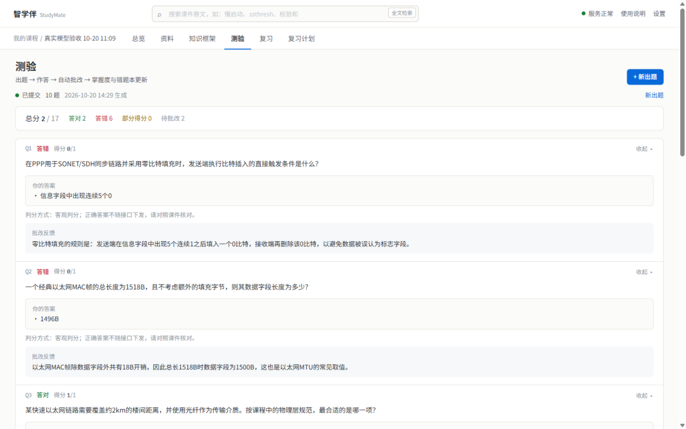
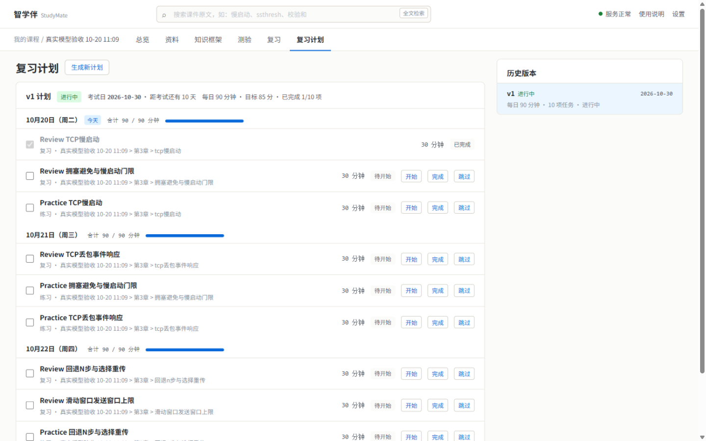
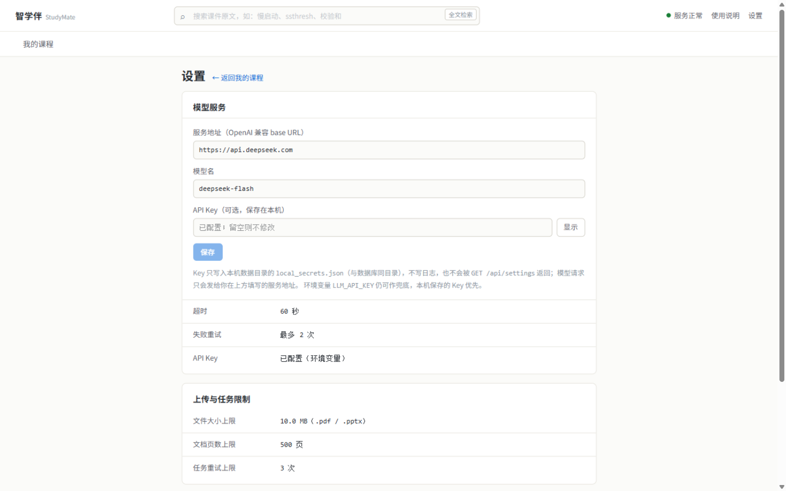

# 智学伴 StudyMate

> 面向中国高校本科生的本地 AI 期末复习工作台：把课件变成**带出处的知识框架、可提交的测验和可执行的复习计划**。
>
> 核心差异化：**靠“测”，不靠“问”** —— 不依赖学生自述哪里不会，而是根据作答记录、错因证据和掌握度估计决定下一步复习什么。



## 当前状态

> 当前是**本地单用户版**，适合在自己电脑上使用或做比赛演示；没有账号体系，也没有多用户隔离，**不要直接暴露到公网**。

| 维度 | 状态（2026-10-21） |
|---|---|
| 后端 | 内部 Stage 8 已完成，并补齐本地 LLM 密钥、部署入口与知识框架修复 |
| 前端 | 课程、总览、资料（含详情）、知识框架、测验、复习、计划、设置等 9 个页面已接入真实接口 |
| 测试 | 后端 `pytest` 50 passed；前端 `vitest` 63 passed；`npm run build` 通过 |
| 部署 | 多阶段 Docker 镜像已在 7860 单容器验证（2026-10-20）；已上线魔搭创空间在线演示（2026-10-21，见「快速开始 · 方式一」） |
| 模式 | `mock://local` 可离线跑通全流程；也支持任意 OpenAI 兼容服务 |

## 它解决什么问题

| 痛点 | StudyMate 的做法 |
|---|---|
| 课件太多，不知道先看哪一页 | 从 PDF/PPTX 抽取知识框架，每个知识点保留文件名、页码和原文片段 |
| “感觉会了”但一考就错 | 用选择题/简答题测验，客观题后端判分，简答题按评分要点批改 |
| 错题看完就忘 | 错题本记录知识缺口；复习目标把薄弱点直接变成下一轮测验 |
| 复习没有节奏 | 按考试日期和每日分钟数生成任务，每天额度不超限，任务状态可追踪 |
| 数据不想上传到云端 | 课件、作答、计划默认保存在本机 SQLite/文件中；启用真实模型时，必要的材料片段会发送到你配置的 LLM 服务 |

## 功能一览

| 模块 | 已实现 |
|---|---|
| 课程与资料 | 课程 CRUD；PDF/PPTX 上传、逐页解析、页码级出处、全文子串检索、被引用材料删除保护 |
| 知识框架 | 异步构建 + 任务轮询、版本化、按资料分组、节点详情与原文出处 |
| 测验 | 单选 / 多选 / 简答出题；客观题确定性判分；简答按 rubric 批改；幂等提交 |
| 掌握度与复习 | Beta-Binomial 掌握度估计、证据计数、错题本（知识缺口）、复习目标 |
| 复习计划 | 按考试日与每日时长生成计划、保留历史版本、任务状态迁移 |
| 设置与演示 | 页面可改服务地址/模型/API Key；`mock://local` 演示模式；健康状态展示 |

> 掌握度是暂定的工程估计，不是精确测量；界面上的“未测验”不等于“薄弱”。

## 界面

| 资料库：逐页解析与警告状态 | 知识框架：知识点 + 原文出处 |
|---|---|
|  |  |

| 测验：提交后自动批改 | 复习计划：按天分组、容量受限 |
|---|---|
|  |  |

更多界面（课程列表、今日清单、知识框架分组、测验作答、错题与薄弱点、设置）见 [`docs/screenshots/`](docs/screenshots/)。

> 截图为真实模型验收课程，仅用于展示界面；`mock://local` 模式下题目内容是英文模板，适合流程演示。

## 快速开始

### 方式一：在线体验（魔搭创空间）

应用已部署在魔搭（ModelScope）创空间，打开即用，无需安装：

- **创空间页面**：<https://modelscope.cn/studios/SUN4713/StudyMate>（页内直接运行，推荐入口）
- **独立地址**：<https://sun4713-studymate.ms.show>
- **API 直连**（程序调用）：`https://studio-sun4713-studymate.api-inference.modelscope.net`，请求头需带 `Authorization: Bearer <魔搭访问令牌>`

功能与本地版完全一致：新建课程 → 上传 PDF/PPTX 课件 → 构建知识框架 → 生成测验并提交 → 查看掌握度、错题与复习计划。SQLite 数据库与上传文件保存在创空间的持久化目录，实例重启不丢失。

使用提示：

- 默认模型服务为魔搭 API-Inference（`Qwen/Qwen3-32B`），需先在魔搭「账号设置」**绑定阿里云账号**，免费调用额度才可用；也可以在应用「设置 → 模型服务」改用任意 OpenAI 兼容服务（DeepSeek、GLM、OpenAI 等），保存后下一次调用即生效。
- 免费实例按需分配，闲置一段时间会休眠，再次访问需等待约半分钟唤醒。
- 演示实例没有登录鉴权，所有访问者共享同一份数据：请只用于体验与评审，不要上传真实个人课件。

想部署到自己的创空间：创建时 SDK 选择 **Docker**，把本仓库推送到创空间仓库的 `master` 分支（构建分支固定为 master），平台按根目录 `Dockerfile` 构建镜像——监听 `0.0.0.0:7860`、`/mnt/workspace` 持久化、单 worker 等平台约定已内置；`LLM_*` 等配置通过创空间「设置 → 环境变量 / 秘钥」注入。注意：推送代码不会自动重建，需在创空间页面点击重新部署（或调用部署 API）触发构建。

### 方式二：Docker（本地体验）

要求本机已安装 Docker Desktop，并预留 `7860` 端口。

```bash
docker build -t studymate:local .

docker run -d --name studymate \
  -p 7860:7860 \
  -v studymate-data:/mnt/workspace/studymate \
  -e LLM_BASE_URL=mock://local \
  studymate:local
```

镜像约 283 MB；首次构建需要拉取 `node:24.13.0-bookworm-slim` 和 `python:3.13-slim-bookworm`。

打开 <http://127.0.0.1:7860>，健康检查：

```bash
curl http://127.0.0.1:7860/api/health
```

- `mock://local` 是内置假模型，不消耗 API 配额，适合先体验完整流程。
- SQLite、上传文件和本机 API Key 都在 `/mnt/workspace/studymate`，挂载卷后容器重建不会丢。
- 停止/再次启动：`docker stop studymate` / `docker start studymate`；查看日志：`docker logs -f studymate`。

接真实模型有两种方式：

1. **在页面里配置（推荐）**：打开「设置 → 模型服务」，填写服务地址、模型名和 API Key，保存后下一次出题/知识构建立即生效，无需重启。
2. **用环境变量启动**：

```bash
docker run -d --name studymate \
  -p 7860:7860 \
  -v studymate-data:/mnt/workspace/studymate \
  -e LLM_BASE_URL=https://api.deepseek.com \
  -e LLM_MODEL=deepseek-chat \
  -e LLM_API_KEY=sk-... \
  studymate:local
```

页面保存的 Key 优先于环境变量；Key 不会写进 SQLite 普通设置表，也不会经接口返回或写入日志。

### 方式三：本地开发

要求：Python ≥ 3.12（实测 3.13）、Node.js ≥ 24、npm。

后端：

```bash
python -m venv .venv
source .venv/bin/activate          # Windows: .venv\Scripts\activate
pip install -e ".[dev]"
cp .env.example .env
alembic upgrade head
uvicorn app.main:app --host 127.0.0.1 --port 8000
```

无 Key 离线启动：

```bash
LLM_BASE_URL=mock://local uvicorn app.main:app --host 127.0.0.1 --port 8000
```

前端（另开终端）：

```bash
cd frontend
npm install
npm run dev
```

打开 <http://localhost:5173>。Vite 会把 `/api` 代理到 `127.0.0.1:8000`。

## 配置

以 [`.env.example`](.env.example) 为模板，常用项：

| 变量 | 默认值 | 说明 |
|---|---|---|
| `APP_ENV` | `development` | 环境标识，健康检查会返回 |
| `DATABASE_URL` | `sqlite:///./data/studymate.db` | SQLite 路径；本地单文件库 |
| `STORAGE_ROOT` | `./data/uploads` | 上传文件目录 |
| `LLM_BASE_URL` | 空 | OpenAI 兼容服务地址；`mock://local` 启用内置假模型 |
| `LLM_MODEL` | 空 | 模型名，例如 `deepseek-chat` |
| `LLM_API_KEY` | 空 | 环境变量兜底密钥；页面保存的本机 Key 优先 |
| `LLM_TIMEOUT_SECONDS` | `60` | 单次 LLM 请求超时 |
| `LLM_MAX_RETRIES` | `2` | 临时失败重试次数 |
| `MAX_UPLOAD_BYTES` | `10485760` | 单文件大小上限（10 MB） |
| `MAX_DOCUMENT_PAGES` | `500` | PDF/PPTX 页数上限 |
| `JOB_MAX_ATTEMPTS` | `3` | 后台任务最大尝试次数 |
| `LOCAL_SECRETS_PATH` | 空 | 可选：覆盖本机密钥文件路径 |

### 配置优先级

- **模型服务**：设置页保存到 SQLite 的 `llm_base_url`、`llm_model`、超时和重试覆盖环境变量，下一次 LLM 调用生效，无需重启。
- **API Key**：设置页保存的 Key 存在数据库同目录的 `local_secrets.json`（POSIX 下尽量收紧为 `0600`），优先于环境变量 `LLM_API_KEY`；不写入普通设置表，不返回给前端，不写日志。`PUT /api/settings` 传 `{"llm_api_key": ""}` 可清除本机 Key。
- **上传与任务限制**：`MAX_UPLOAD_BYTES`、`MAX_DOCUMENT_PAGES`、`JOB_MAX_ATTEMPTS` 仍以环境变量为准；`PUT /api/settings` 里对应的覆盖值目前只影响 `GET /api/settings` 的显示。
- **服务器路径**：`GET /api/settings` 会返回真实的 `database_url` 和 `storage_root`，设置页刻意不展示。



## 工作原理

```text
浏览器 SPA（React + HashRouter）
        │  /api/*
        ▼
FastAPI routes → services → repositories → SQLite
        │
        ├─ 进程内 job worker：解析资料 / 构建知识框架 / 出题
        └─ LLMAdapter：OpenAI 兼容服务，或 mock://local
```

| 层 | 技术 |
|---|---|
| 前端 | React 19、Vite 8、TypeScript 5.9、Tailwind CSS 4、TanStack Query 5、HashRouter |
| 后端 | FastAPI、Pydantic 2、SQLAlchemy 2、Alembic |
| 数据 | SQLite + 本地文件存储；无 Redis/Celery |
| 部署 | 多阶段 Docker：Node 24 构建 SPA，Python 3.13 运行 API；单端口 7860 |
| 测试 | pytest（后端）、Vitest + MSW（前端） |

## 目录结构

```text
StudyMate/
├─ app/
│  ├─ api/routes/        # 路由
│  ├─ schemas/           # 请求/响应模型
│  ├─ services/          # 业务逻辑（课程、资料、知识、测验、掌握度、计划、设置）
│  ├─ repositories/      # 数据访问
│  ├─ db/                # SQLAlchemy 模型与会话
│  ├─ jobs/              # 进程内任务 worker
│  └─ llm/               # OpenAI 兼容适配器与 mock
├─ alembic/              # 数据库迁移
├─ tests/                # unit / integration / e2e
├─ frontend/             # React SPA（见 frontend/README.md）
├─ deploy/               # serve.py 容器入口 + constraints.txt
├─ docs/                 # 后端规范、演示脚本、测试与评审报告、截图
├─ scripts/              # 手工冒烟脚本与 fixture 生成器
├─ data/                 # 本地运行数据（gitignored）
├─ Dockerfile
├─ .dockerignore
└─ pyproject.toml
```

## API 一览

所有业务接口都在 `/api` 前缀下；`/openapi.json` 和 `/docs` 在根路径。

| 模块 | 接口 |
|---|---|
| 系统 | `GET /api/health`；`GET /api/settings`；`PUT /api/settings` |
| 课程 | `POST/GET /api/courses`；`GET/PATCH/DELETE /api/courses/{course_id}` |
| 资料 | `POST/GET /api/courses/{course_id}/materials`；`GET/DELETE /api/materials/{material_id}`；`GET /api/courses/{course_id}/search`；`GET /api/chunks/{chunk_id}` |
| 知识 | `POST /api/courses/{course_id}/knowledge/build`；`GET /api/courses/{course_id}/knowledge`；`GET /api/courses/{course_id}/knowledge/graph`；`GET /api/courses/{course_id}/knowledge/tree`；`GET /api/courses/{course_id}/knowledge/highlights`；`GET /api/courses/{course_id}/knowledge/merge-decisions`；`GET/POST/DELETE /api/courses/{course_id}/knowledge/alias-locks`；`POST /api/courses/{course_id}/knowledge/alias-locks/delete`；`GET /api/knowledge/{knowledge_point_id}`；`GET /api/courses/{course_id}/knowledge/versions` |
| 测验 | `POST /api/courses/{course_id}/quiz/generate`；`GET /api/quizzes/{quiz_id}`；`POST /api/quizzes/{quiz_id}/submit` |
| 掌握度/复习 | `GET /api/courses/{course_id}/mastery`；`GET /api/courses/{course_id}/wrongbook`；`POST /api/courses/{course_id}/review-targets` |
| 计划 | `POST /api/courses/{course_id}/plan`；`GET /api/courses/{course_id}/plans`；`GET /api/plans/{plan_id}`；`PATCH /api/tasks/{task_id}` |
| 任务 | `GET /api/jobs/{job_id}`；`GET /api/jobs/{job_id}/llm-calls` |

## 关键行为与客户端约定

- **错误信封**：业务错误为 `{"error": {"code", "message", "details", "request_id"}}`，并带 `x-request-id` 头；路由层 404/405 可能是 FastAPI 默认的 `{"detail": "..."}`。
- **异步任务**：上传、建知识框架、出题返回 `job_id`；轮询任务到 `succeeded` / `failed` / `cancelled`。`progress` 只有 0 和 100，不能做真实进度条。
- **知识框架空状态**：活动框架不存在时，`GET /knowledge`、`GET /knowledge/tree`、`GET /knowledge/highlights` 都返回 `404 RESOURCE_NOT_FOUND`，这是“尚未构建”，不是服务故障。
- **跨文档/跨 section 对齐**：Stage C 在落库前把同一概念的不同标题（空字符差异精确合并；`difflib` 相似度 ≥0.90 且 ASCII 字母数字骨架一致视为 fuzzy，不做子串合并，避免“物理层”吞掉“物理层机械特性”）并成一个 canonical 叶，`sources` 取并集（最多 6 条），其余标题进 `aliases`；`GET /knowledge/merge-decisions` 只列真正发生合并的簇；`POST/DELETE /knowledge/alias-locks` 可把一对标题锁定为“永不合并”（按课程、无序对、幂等）；魔搭网关拒绝 DELETE，线上解绑走 `POST /knowledge/alias-locks/delete`。合并在关系解析前完成，关系 ref 会重映射到 canonical。版本级守卫保证同一框架版本内一个 `knowledge_node_id` 至多一行 node_version；graph/tree/highlights 读取层再按 node id 与 `(source,target,type)` 去重。前端知识页的「整合记录」视图列出合并簇并可锁定/解绑；「关系图」为关系边列表（不引入图形库）。
- **重难点评分**：`GET /knowledge/tree` 在旧树节点上追加 `importance` / `difficulty`（容器取后代最大值，叶子另带 `components` 五分量原值：出处页数、关系中心性、篇幅、测验题数、跨文档覆盖数）；`GET /knowledge/highlights?limit=20&order=importance|difficulty|gap` 返回 `{items, basis}`，`order=gap` 用 `importance × (1 − mastery_estimate)`，未测验的排在最后且 `untested: true`（未测验 ≠ 薄弱）。分数在读取时计算，不落库、不调 LLM；`limit` 上限 50，非法 `order` 或越界 `limit` 返回 422 `VALIDATION_ERROR`；旧 `GET /knowledge` 与详情接口保持不变。
- **测验幂等**：一份测验只能提交一次，且必须每题都有答案；同一幂等键 + 同一答案重试会返回已保存结果，换新键会得到 `409 QUIZ_NOT_OPEN`。
- **简答批改**：在提交请求内同步调用 LLM；临时失败返回 503 且不落库，可用同一幂等键重试。
- **计划任务**：`completed` / `skipped` 是终态，不能撤回。
- **静态文件**：后端本身不挂载前端构建；`deploy/serve.py` 在容器入口把 `frontend/dist` 挂在 API 路由之后。

## 测试与验证

```bash
# 后端（仓库根目录）
pytest -q

# 前端
cd frontend
npm run test
npm run build
```

当前基线（2026-10-23）：后端 **154 passed**（约 104 秒），前端 **63 passed**，生产构建通过。测试使用 mock LLM 或本地替身，不需要真实 API Key。

- Docker 构建、7860 启动、完整 mock 流程与重启持久化记录：[`docs/testing/docker-deployment-report-2026-10-20.md`](docs/testing/docker-deployment-report-2026-10-20.md)
- 真实模型验收、已知结构化输出问题记录：[`docs/testing/real-model-acceptance-report-2026-10-20.md`](docs/testing/real-model-acceptance-report-2026-10-20.md)

## 已知限制

- **单用户、无认证、无工作区隔离**：所有课程和资料对访问者可见，只适合本机或受信内网。
- **设置写接口无鉴权**：`PUT /api/settings` 可以修改服务地址、模型和本机 API Key；把服务暴露到公网前必须关闭该接口或加认证，否则访客可能借服务端 Key 发起模型请求。
- **单实例**：SQLite + 进程内 job worker，只能跑一个 uvicorn worker；不支持多副本和高可用。
- **线上删除走 POST 别名**：魔搭 API 网关拒绝 `DELETE` 方法（403 `AccessDenied: unauthorized method 'DELETE'`），因此前端删除课程/资料调用 `POST /api/courses/{id}/delete` 和 `POST /api/materials/{id}/delete`；后端保留原 `DELETE` 路由供本地与脚本使用。
- **解析范围**：支持 `.pdf` / `.pptx`，旧版 `.ppt` 和 OCR 尚未实现；扫描页会如实标记“无可提取文本”。
- **章节树由大纲推断**：无书签的幻灯片型 PDF 由模型归并为章节，一级章节数上限为 `max(20, ceil(页数/12))`，叶子必须 ≥ level 2。模型给不出合格结构时构建显式失败（`KNOWLEDGE_OUTLINE_FAILED`），不会退回“一页一章节”的平铺树。大纲会缓存，重建不重复调用。单章教材会被收敛成“文档级章 → 节”两级（`wrap_document_outline`），章首、章尾和节间未被小节声明的页面并入相邻小节（`absorb_chapter_lead_in`），每章页码连续、不会漏抽。
- **知识点关系是模型判断，不是课程事实**：构建时同一次抽取里产出的 `prerequisite / derives / causes / contrasts_with / applies_to / counterexample_of` 六类关系随框架版本落库，详情接口和 `GET /courses/{id}/knowledge/graph` 可读；关系只在同一次抽取窗口内产生（跨 section 对齐后 ref 会重映射到 canonical），自环、未知类型、越界置信度和引用被丢弃叶子的关系会被直接丢弃（不会让构建失败），每叶最多 3 条。关系不参与判分和掌握度计算。
- **叶子密度受窗口页数与预算限制**：每个抽取窗口的叶子预算按覆盖页数缩放（`clamp(页数/2, 10, 20)`），幻灯片型 PDF 的“页”才是一个知识单元，因此大教材约为“节数 × 10–20”个知识点，不会按页数线性增长；实测 425 页课 258 叶、187 页课 98 叶。预算值已并入 section 缓存键，调参后重建会自动全量重抽。
- **重难点分数是工程估计，不是教材重要性事实**：`importance = 0.25·出处页数 + 0.25·关系中心性 + 0.15·篇幅 + 0.15·测验题目数 + 0.20·跨文档覆盖数`（各分量按全体叶最大值归一化，`scoring-v2`），`difficulty = 0.5·前置链深度 + 0.3·前置入度 + 0.2·篇幅`。权重是 `app/services/knowledge_scoring.py` 里的模块常量，改权重立即生效、无需重建或迁移。它度量的是“抽取出处有多密”，没有语义先验：只被抽到 1 页、没有关系的重点概念会排在后面；重新作答前测验分量为 0，`order=gap` 与 `order=importance` 等价。分数与掌握度都只是参考估计，不能写成精确测量。
- **mock 内容有限**：内置假模型输出英文模板题，适合流程演示，不适合展示题目质量。
- **真实模型依赖服务商**：需要 OpenAI 兼容接口；结构化输出失败、超时或限流会影响出题与简答批改。
- **掌握度是估计值**：Beta-Binomial 更新只覆盖主要知识映射，不向关联节点传播；不能当作精确测量。
- **接口缺口**：没有变式题、dashboard 聚合、LLM 连通测试、quiz 列表、job 列表、demo/seed 接口；前端用“错题本/复习目标 → 再出题”完成闭环。
- **设置覆盖范围有限**：上传/页数/任务重试上限仍以环境变量为准；页面只负责展示。
- **后端不托管 SPA**：容器用 `deploy/serve.py` 补上静态托管；直接运行后端时访问 `/` 仍是 404。

## 常见问题

| 现象 | 处理 |
|---|---|
| 容器启动后页面打不开 | `docker logs -f studymate`；确认 `GET /api/health` 返回 200，端口映射是 `7860:7860` |
| 出题/建框架提示 `LLM_NOT_CONFIGURED` | 在设置页填服务地址、模型名和 Key；或启动时加 `-e LLM_BASE_URL=mock://local` |
| 健康检查返回 `DATABASE_SCHEMA_OUTDATED` | 执行 `alembic upgrade head`；容器入口会自动执行 |
| 上传被拒绝 | 只支持 `.pdf` / `.pptx`，默认单文件 10 MB、500 页；检查 `MAX_UPLOAD_BYTES` / `MAX_DOCUMENT_PAGES` |
| 7860 被占用 | 改用 `-p 7861:7860`，容器内仍监听 7860 |
| 数据与 Key 在哪 | 本地默认 `data/`；Docker 在 `/mnt/workspace/studymate`。备份 `studymate.db`、`uploads/` 和 `local_secrets.json`（后者按密钥保管） |

## 文档

| 文档 | 内容 |
|---|---|
| [`frontend/README.md`](frontend/README.md) | 前端结构、命令、联调方式与视觉基线 |
| [`docs/spec/backend-spec.md`](docs/spec/backend-spec.md) | 后端技术设计与实现规范 |
| [`docs/spec/environment.md`](docs/spec/environment.md) | 开发环境基线 |
| [`docs/demo/demo-script.md`](docs/demo/demo-script.md) | 5 分钟演示脚本 |
| [`docs/testing/`](docs/testing/) | 真实模型与 Docker 验收报告 |
| [`docs/reviews/`](docs/reviews/) | 后端设计复盘与改进提案 |
| [`docs/screenshots/`](docs/screenshots/) | 产品界面截图 |
